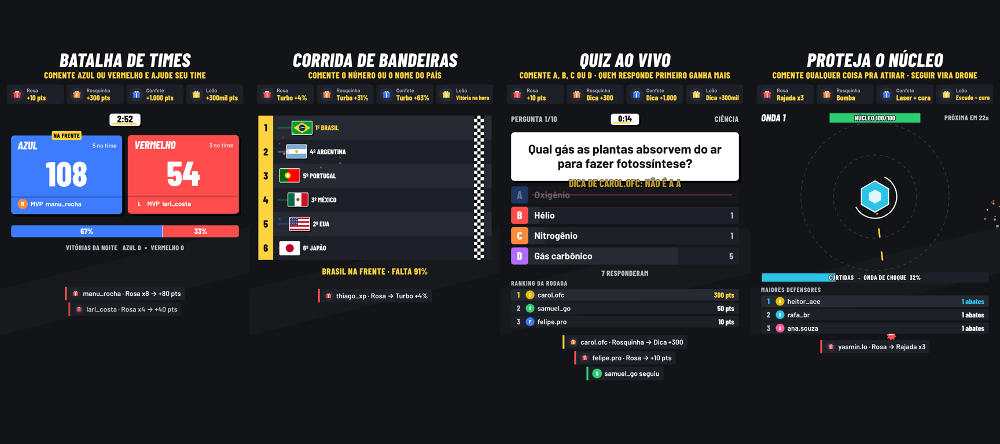

# Live Interativa — sistema de live automática pro TikTok

Quatro jogos que a plateia controla pelos comentários, curtidas, presentes e
seguidores. Você escolhe qual jogo vai pro ar no painel, na hora.

| Jogo | Como a galera joga | Presente faz o quê |
|---|---|---|
| **Batalha de Times** | Comenta o nome do time (AZUL/VERMELHO ou 1/2). Cada comentário = ponto | Pontos em massa pro time de quem mandou |
| **Corrida de Bandeiras** | Comenta o número ou nome do país pra empurrar | TURBO |
| **Quiz ao Vivo** | Comenta A, B, C ou D. Mais rápido = mais pontos | Pontos extras + DICA (elimina uma errada) |
| **Proteja o Núcleo** | Qualquer comentário atira nos inimigos | Rajada, bomba, laser, escudo (depende do tamanho) |



Todos os jogos **recomeçam sozinhos** no fim de cada rodada. Por isso a live roda
no automático.

---

## 1. Ligar o sistema

Precisa do **Node.js** instalado (versão LTS em https://nodejs.org). É só uma vez.

- **Windows:** dois cliques em `iniciar-windows.bat`
- **Mac:** dois cliques em `iniciar-mac.command` (se o Mac bloquear: botão direito → Abrir)

Na primeira vez ele instala o que precisa (demora 1 a 2 minutos). Depois abre o
painel sozinho no navegador. Se não abrir, entre em **http://localhost:3000/painel**.

Pra desligar, feche a janela preta (ou aperte Ctrl+C nela).

> Pelo terminal: `cd live-interativa`, depois `npm install` (só na primeira vez) e `npm start`.

---

## 2. Testar sem estar ao vivo

No painel:

1. Escolha o jogo em **Jogo na tela**.
2. Ligue **Plateia automática** (simula gente comentando, curtindo e mandando
   presente). Use "Caótica" pra ver a tela cheia.
3. Ou mande eventos na mão: digite um comentário, clique num presente, "+15 curtidas"…
4. Veja o resultado na **Prévia** (lado direito) ou clique em **Abrir tela em nova aba**.

---

## 3. Colocar na live de verdade

### a) A tela do jogo na transmissão

O jogo é uma página: **http://localhost:3000/overlay**

**No OBS** (com chave de transmissão do TikTok):
1. Fontes → **+** → **Navegador**
2. URL: `http://localhost:3000/overlay`
3. Largura **1080**, Altura **1920**
4. Marque **"Controlar áudio via OBS"** se quiser os sons do jogo
5. A cena do OBS também deve estar em 1080×1920 (vertical): Configurações → Vídeo

**No TikTok LIVE Studio:** se ele oferecer fonte de "navegador/link", use a mesma
URL. Se não oferecer, abra a tela do jogo numa janela do navegador e use **captura
de janela**.

Opções da URL (dá pra combinar com `&`):
- `?transparente=1` deixa o fundo transparente, pra colocar o jogo por cima da sua câmera
- `?som=0` tira o som
- `?guias=1` mostra quais áreas a interface do TikTok cobre no celular (só pra ajustar, não use na live)

### b) Ligar os comentários e presentes de verdade

1. **Abra a live no TikTok primeiro.**
2. No painel, em **Conectar na live do TikTok**, digite seu @ e clique em **Conectar**.
3. Quando a pílula do topo ficar verde ("TikTok: conectado"), os eventos reais
   começam a chegar. Aparecem em **Eventos chegando**.
4. Desligue a plateia automática quando estiver ao vivo de verdade.

> A conexão usa uma biblioteca **não-oficial** (`tiktok-live-connector`). Ela
> funciona bem, mas pode parar quando o TikTok muda algo. A correção costuma ser
> atualizar a biblioteca: `npm update tiktok-live-connector`.
>
> Ela usa um serviço externo de "assinatura" (Euler Stream). Sem chave funciona,
> mas com limite de uso. Se cair muito, crie uma conta grátis em eulerstream.com e
> cole a chave no painel. Sua chave fica só no seu computador
> (`config/tiktok.local.json`, que não vai pro GitHub).

---

## 4. Personalizar

Tudo fica em **Configurações avançadas** no painel (ou nos arquivos da pasta `config/`):

- `config/config.json`: tempos, pontos, nomes e cores dos times, países da
  corrida, vida do núcleo, valores dos presentes
- `config/perguntas.json`: perguntas do quiz. Formato:
  ```json
  { "pergunta": "Qual é a capital do Brasil?", "alternativas": ["São Paulo", "Brasília", "Rio", "Salvador"], "correta": 1, "categoria": "Geografia" }
  ```
  `correta` começa do 0 (0 = primeira alternativa). A ordem das alternativas é
  embaralhada na tela, então a letra certa muda a cada vez.

Exemplos:
- **3 ou 4 times:** adicione itens em `batalha.times` (`nome`, `cor`, `palavras`)
- **Corrida de times de futebol:** troque `corrida.corredores`. Sem bandeira
  pronta, use `"cores": ["#hex", "#hex"]` e `"orientacao": "h"` ou `"v"`
- **Faixas de presente** (`presentes.faixas`): a partir de quantos diamantes um
  presente é médio, grande ou lendário
- **Legenda de presentes no topo** (`presentes.legenda`): quais presentes aparecem
  (até 4). As imagens vêm do TikTok depois da primeira conexão numa live real, ou
  coloque a sua em `public/img/presentes/` e use `"imagem": "/img/presentes/rosa.png"`

---

## 5. Como funciona por dentro

```
TikTok ──(tiktok-live-connector)──┐
                                  ├─► server.js ──WebSocket──► /overlay (tela do jogo, vai pro OBS)
Simulador (src/simulador.js) ─────┘                       └──► /painel  (controle)
```

- `server.js`: servidor, conexão com a live, simulador, repasse dos eventos
- `src/tiktok.js`: converte os eventos do TikTok pro formato do sistema
- `public/js/motor.js`: efeitos, partículas, sons, alertas de presente
- `public/js/jogos/*.js`: um arquivo por jogo (pra criar jogo novo, copie um deles)
- `public/js/painel.js`: painel de controle

Áreas seguras da tela (1080×1920): o topo (até ~210px) fica coberto pelo nome e
espectadores do TikTok, e a parte de baixo (a partir de ~1170px) pelos comentários.
O conteúdo importante dos jogos fica no meio.
